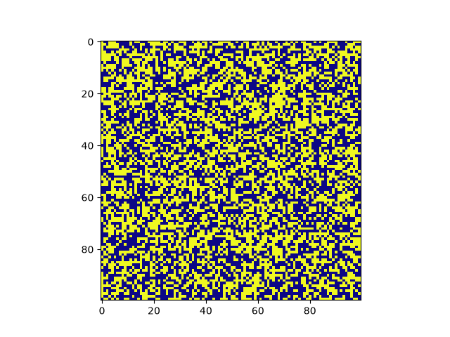

# Classical Ising Model at Zero Temperature

## Overview

A learning project exploring the **classical Ising model** from statistical mechanics. The code simulates a 2D ferromagnet at zero temperature, evolving spin configurations through energy-minimizing updates until reaching one of three metastable states: uniform, horizontal stripes, or vertical stripes.

The main goals are to study the probability distribution of these final states from randomized initial configurations and create visualizations and animations of the system's evolution.

## How It Works

1. **Initialize the lattice:** Generate a random spin configuration or manually specify one.
2. **Identify energetic spins:** Find spins that are not aligned with their local magnetic environment.
3. **Minimize energy:** Randomly select and flip energetic spins, updating the local neighbourhood until the system stabilizes.
4. **Classify the final state:** Determine whether the lattice has reached a uniform or striped configuration.
5. **Collect statistics:** Repeat simulations to estimate the probability of reaching each metastable state from random initial conditions.

## Example Animation

The following shows how the ising model converges to a metastable state from a random starting configuration.



Note: more interesting animations can be found in the animations file.

## Main Functions

- `Ferromagnet(shape)` — Represents the spin lattice, with methods for updating spins, calculating energy, and evolving the system.
- `energetic_update()` — Flips a randomly selected energetically unfavourable spin and updates nearby sites.
- `minimize_energy()` — Iterates until no energetic spins remain.
- `get_energy()` — Calculates the total nearest-neighbour interaction energy.
- `classify()` — Identifies the final metastable state.
- `sample_metastable_state(shape)` and `accumulate_stats(shape)` — Sample final states and record their frequencies.
- `plot()` — Visualizes the current spin configuration.
- `make_animation()` and `make_metastable_animation()` — Generate animations of the system's evolution.
- `live_plot_metastable()` — Displays the lattice evolving in real time.

## Running the Script

**Requirements:** Python 3, NumPy, and Matplotlib.

```bash
pip install numpy matplotlib
python main.py
```

The lattice size and initial configuration can be adjusted near the bottom of the script. The current example initializes a random \(40 \times 40\) lattice and visualizes its evolution.

## Future Improvements

- Run large Monte Carlo ensembles to estimate the probability distribution of metastable states for different lattice sizes.
- Investigate how these probabilities scale with system size and initial conditions.
- Improve simulation performance by optimizing local energy updates and data structures.
- Add more flexible initial configurations and boundary conditions.
- Create additional visualizations to explore domain formation, stripe patterns, and the dynamics of energy minimization.

